<p align="center">
  
</p>

<h1 align="center">Psiu</h1>

<p align="center">
  A tiny robot in your Mac's notch that tells you when Claude Code needs you.<br>
  <a href="https://jaimebrolesi.github.io/psiu/">Website</a> · <a href="README.pt-BR.md">Leia em português</a>
</p>

<p align="center">
  
</p>

*"Psiu!"* is how Brazilians say *"psst!"*: the little sound you make to get someone's attention. That is all Psiu does.

## Why

You give Claude Code a long task, switch to the browser or a meeting, and forget to come back. Twenty minutes later you find it has been waiting for a permission since minute two. Psiu sits in the notch, shows at a glance what every session is doing, and calls you, with a color and a sound, when a session finishes or needs you.

<p align="center">
  
</p>

## What the robot shows

<p align="center">
  
</p>

| | State | What it means | Sound |
|---|---|---|---|
| 1 | **Blue, eyes scanning** | Claude is working | none |
| 2 | **Blue, slow scan and blink** | The turn ended, but shells, monitors or subagents are still running in the background | none |
| 3 | **Yellow, eyes and "!" alternating** | Claude needs you: a permission or a question | right away, then every 2 minutes for up to 30 minutes |
| 4 | **Green, smiling** | Finished | after 3 seconds, plus one reminder after 3 minutes if you have not looked |
| 5 | **Dim green, half-closed eyes** | Idle, and you have already seen it | none |
| 6 | **Gray, "Z z" eyes** | No Claude Code session open | none |

With several sessions open, the robot shows the most urgent one: yellow beats blue, blue beats green.

The number next to the robot is how much of your 5-hour plan window you have used.

## Two little dots

<p align="center">
  
</p>

- **Green dot**: another session finished and you have not seen it, while the robot is busy showing something more urgent.
- **Red dot**: a session is above 80% of its context window, close to being compacted. When its eyes are free, the robot also looks tired, with a drop of sweat.

Each dot only appears when it tells you something the robot is not already showing.

## The panel

Click the notch and it stretches down into a panel. Click it again, or anywhere else, to close it.

<p align="center">
  
</p>

- **5-hour window and week**, with when they reset. Based on the last hour, Psiu tells you if your current pace runs out the 5-hour window before it resets.
- **Every session**, with its state, a one-line summary of what it finished or what it is asking for, and its context usage. Click a session to bring its terminal window to the front (Terminal and iTerm jump to the exact tab; VS Code, Cursor and others bring the app forward).
- **Today**: how long agents worked, how long they waited for you, and your average response time, plus the last 7 days. A small, honest mirror.

Right-click the robot for: **Show on** (pick which displays), **Mute sounds**, **Test sounds**, **Quit** and **Uninstall**.

On displays without a notch, like an external monitor, Psiu draws a notch of the same size at the top of the screen.

## Install

1. Download `Psiu.dmg` from the [latest release](https://github.com/jaimebrolesi/psiu/releases/latest).
2. Open it and drag Psiu into Applications.

<p align="center">
  
</p>

3. Open Psiu from Applications. Psiu is not notarized by Apple, so the first time macOS will block it. Go to **System Settings → Privacy & Security**, scroll down and click **Open Anyway**.
4. Psiu asks to connect to Claude Code. Click **Connect**: it adds its hooks and status line to `~/.claude/settings.json` (keeping a backup of your original file) and registers itself to open at login.
5. Restart any Claude Code sessions that were already open.

Requirements: macOS 14 (Sonoma) or later, and Claude Code. The plan usage numbers need a Claude Pro or Max subscription.

> The app interface is in Brazilian Portuguese for now.

## Build from source

```bash
xcode-select --install   # once, for the Swift compiler
bash gerar-dmg.sh         # builds Psiu.app and Psiu.dmg in this folder
```

Everything lives in a single file, `Psiu.swift`, with no dependencies.

## How it works

Psiu only uses official Claude Code extension points:

- **Hooks** tell it when a session starts, receives a prompt, uses a tool, asks for permission, finishes or ends. Psiu writes each session's state to `~/.psiu/sessions`.
- The **status line** gives it each session's context usage and your plan limits.
- The app reads those files twice a second and draws the robot.

Your previous status line keeps working: Psiu runs it and shows its output.

**Privacy.** Psiu never connects to the internet, never reads passwords or tokens, and keeps everything in `~/.psiu` on your Mac. The only setting it changes is `~/.claude/settings.json`, with a backup.

## Uninstall

Right-click the robot → **Uninstall Psiu…**. It removes its hooks and status line (your previous status line comes back) and removes itself from login items. Then drag Psiu from Applications to the Trash.

## Limitations

- Only **Claude Code**. The Claude apps and claude.ai do not expose session state.
- The plan numbers update whenever a Claude Code session gets a response. Claude Code does not expose per-model limits.
- If you stop a background task while Claude is idle, no event fires, and the robot stays in "background" until the session's next event.

## License

The code is under the [MIT License](LICENSE): use it, change it, ship it. The **Psiu name, the robot character and the icon** are not part of the MIT license and remain mine; if you publish a fork, please give it your own name and character. See [LICENSE-ASSETS.md](LICENSE-ASSETS.md).

Made by [Jaime Brolesi](https://www.linkedin.com/in/jaimebrolesi), with Claude.
